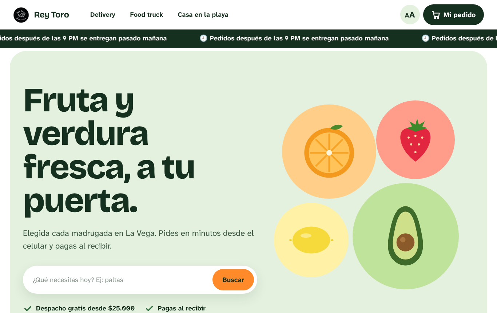
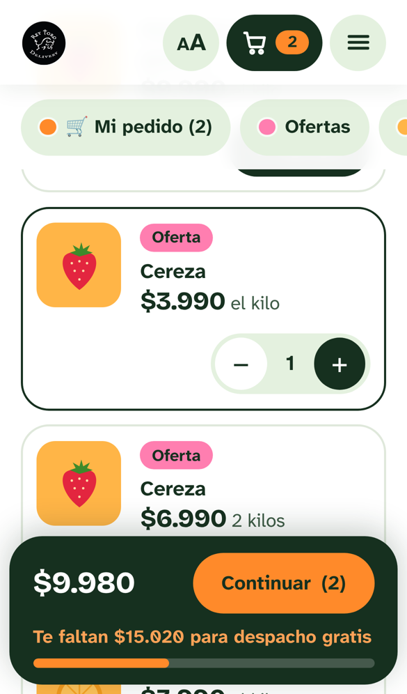
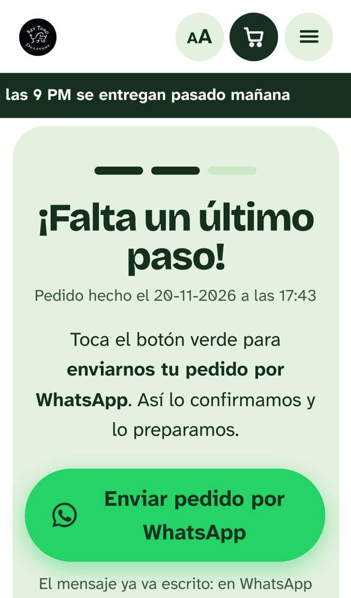

# Rey Toro Delivery

Página web de un negocio familiar de **frutas y verduras a domicilio** en Santiago de Chile, con secciones para el **arriendo de un food truck** y de una **casa en la playa**.

Los clientes eligen sus productos desde el celular, ven su total en vivo y envían el pedido por WhatsApp. Los precios y los pedidos viven en una **planilla de Google Sheets**, que el dueño administra sin conocimientos técnicos.



<p>
  
  
</p>

## Qué resuelve

| Antes | Ahora |
|---|---|
| Lista de precios en Excel enviada a cada cliente | Un link con los precios siempre al día |
| El cliente devolvía un Excel por pedido | El pedido llega como una fila en la planilla, por correo y por WhatsApp |
| Actualizar precios = mandar un archivo nuevo | Se cambia el precio en la planilla y la página se actualiza sola |

## Pensada para gente mayor

- Letra **Atkinson Hyperlegible**, diseñada para personas con baja visión, en tamaño base de 18 px.
- Botón **"Aa"** que agranda toda la página en tres pasos (se recuerda en el navegador).
- Botones de al menos 48 px, textos simples ("$5.990 el kilo") y contraste WCAG AA en todos los colores.
- Navegación completa con teclado, foco visible, enlace "Saltar al contenido" y respeto por "reducir movimiento".
- Diseño **fresco y luminoso**: fondo blanco y menta, títulos en **Bricolage Grotesque** y cada categoría con su color e ilustración propia (dibujos SVG hechos para el proyecto).

## Funcionalidades

- **Lista de precios** por categorías con color e ilustración, buscador sin tildes (también desde la portada), ofertas y filtro "Mi pedido".
- **Carrito** guardado en el navegador, total en vivo y barra de avance hacia el despacho gratis.
- **Repetir mi último pedido** con un toque.
- **Envío del pedido**: se guarda en la planilla (Apps Script), llega un correo de aviso y el cliente lo manda por WhatsApp con el mensaje ya escrito.
- **Food truck y casa en la playa**: galería con visor a pantalla completa y consulta de disponibilidad por WhatsApp (fechas y personas ya escritas en el mensaje).
- **Modo demo**: sin configurar la planilla, la página funciona con productos de ejemplo.

## Arquitectura

```
Navegador (React)  ──GET ?api=catalogo──▶  Google Apps Script  ──▶  Google Sheets
                   ──POST pedido────────▶  (validación, número     (Productos, Pedidos,
                   ◀─ número + mensaje ──   diario, correo aviso)   Configuración)
        │
        └──▶ wa.me (WhatsApp con el pedido escrito)
```

- **Frontend:** React 19, TypeScript, Vite, Tailwind CSS 4, React Router. Publicado en GitHub Pages.
- **Backend:** Google Apps Script (`apps-script/`) sobre la planilla del negocio. Los precios siempre se recalculan en el servidor; la página nunca decide el total.
- **Seguridad:** la API solo expone datos públicos (nunca el correo de avisos ni claves), campo trampa contra robots y límite de productos por pedido.

## Correr el proyecto

```bash
npm install
npm run dev      # http://localhost:5173 (modo demo)
npm test         # pruebas de formatos y carrito
npm run build    # genera dist/
```

Para conectarlo a la planilla real, copia `.env.example` a `.env` y completa `VITE_API_URL` con la URL de la aplicación web de Apps Script (termina en `/exec`).

## Estructura

```
src/
  pages/        Inicio, Pedido (lista), TuPedido, Listo, Arriendo (food truck y casa)
  components/   Encabezado, Ilustracion (dibujos SVG), FilaProducto, Contador, Galeria, Pie…
  state/        Catálogo, carrito y tamaño de letra (React Context)
  lib/          API, formatos, carrito (con pruebas)
  content/      Textos y fotos de los arriendos
apps-script/    Backend en Google Apps Script (planilla, pedidos, impresión)
```

---

Hecho por [Benjamín Stagnaro](https://github.com/benjaminstagnaro).
